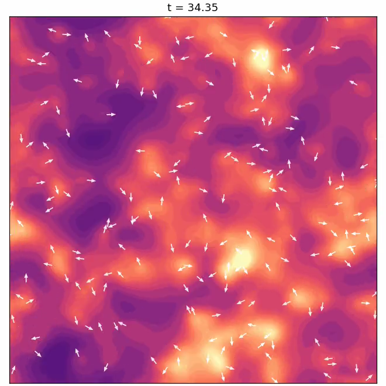
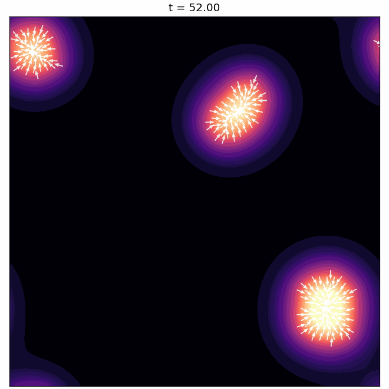
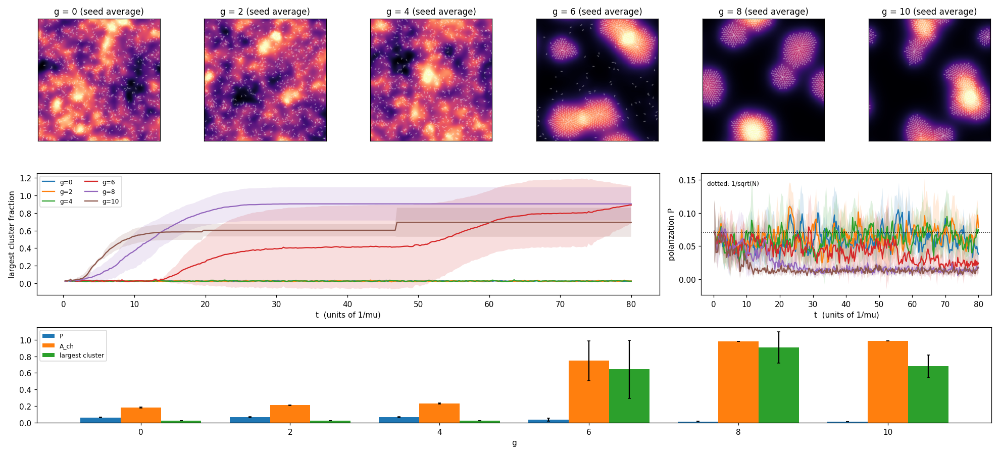

# Chemically Mediated Active Matter

A Python implementation of a 2D active-matter model in which self-propelled particles secrete a diffusing, decaying chemical and steer up the gradient of the chemical made by **other** particles. A particle never senses its own signal, including its old trail. The model supports steric (WCA) repulsion and basic multi-species with arbitrary, including non-reciprocal, couplings. The goal is to understand how chemically mediated interactions drive collective behaviour, starting from the single-species case.




## The model

```
dr_i/dt = Pe p_i + sqrt(2 Dt) xi_i              (+ WCA repulsion, optional)
dθ_i/dt = g_i p_i⊥ · ∇c_{-i}(r_i, t) + sqrt(2 Dr) eta_i
∂t c_j  = ∇²c_j − c_j + s_j K_a(r − r_j(t)),     c_{-i} = Σ_{j≠i} c_j
```

Lengths are in units of the chemical screening length, time in units of the chemical decay time. Control parameters: swimming speed `Pe`, chemotactic strength `g` (g > 0 attraction), rotational diffusion `Dr`, source width `a`, density `N/L²`, and for steric runs particle diameter `sigma` and WCA strength `eps`. Each particle can carry its own `g_i` and secretion `s_i` (species).

**Numerics.** Each particle has its own chemical field, advanced exactly per Fourier mode with an integrating factor. The sensed gradient is the total field minus the particle's own, evaluated by direct Fourier summation, so self-exclusion is exact (an isolated particle feels zero torque to machine precision). WCA uses adaptive substeps because it is stiff. A quasi-static field is available as an option.

## Quick start

```bash
pip install numpy scipy matplotlib

python validate.py                       # 40 checks against analytic solutions

python run [g] [sigma]
python plot_case results/run_g[g]_steric.npz

python explore.py scan_g 
python explore.py plot results/scan_g_steric.npz


```

Defaults used throughout: N = 200, L = 20, Pe = 5, Dr = 0.5, a = 0.25, sigma = 0.4, eps = 0.1, dt = 0.01. Tested with Python 3.12.

## First results

Preliminary: one system size (N = 200), a few seeds per setting.



- **No polar order.** Polarization stays at or below the 1/√N noise level at every g. Chemotaxis aggregates particles but does not align them.
- **Gas to droplets.** With steric repulsion the system is a gas for g ≲ 4 and forms compact droplets with radially inward orientation for g ≳ 8, with stochastic nucleation in between.

## Files

| File | Purpose |
|---|---|
| `chemotactic_abp.py` | the model and observables (polarization, alignment, structure factor, g(r), clusters) |
| `validate.py` | the 40 validation checks |
| `explore.py` | scans, comparisons, two-species runs, plotting |

## Status

- Results are exploratory. Trajectories are chaotic and use single precision, so the same seed is reproducible on one machine but not necessarily across machines.
- `plot_case` in `explore.py` writes frames into `./temp`, which must exist.
- Repo and README will be updated with progress
